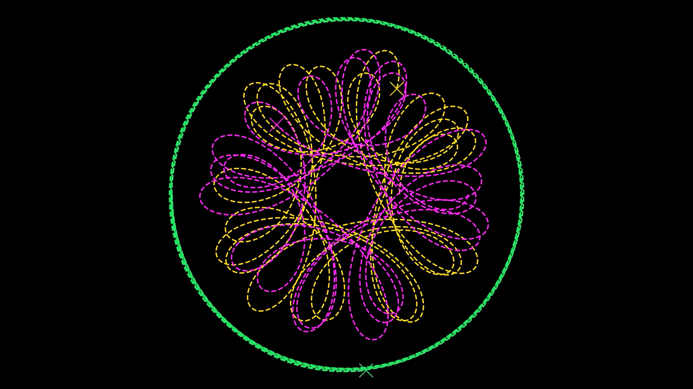
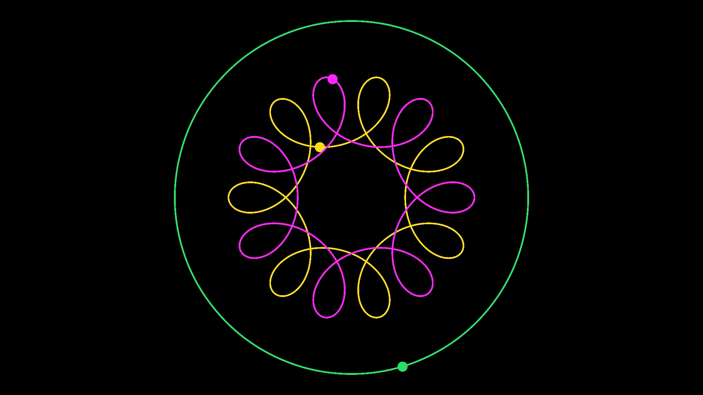

# N body astro c++
A program for simulating the gravitational interaction of bodies in C++.

Supported methods: 
* Euler
* Implicit Euler
* Second-order Runge-Kutta
* Verlet

## Example of different methods: Case: Broucke A 2.yaml
### Euler's method:

### Second-order Runge-Kutta method:

Channel with simulations [GravSim](https://t.me/gravsimchannel)

Examples of simulations on [YouTube](https://www.youtube.com/@GravSim)